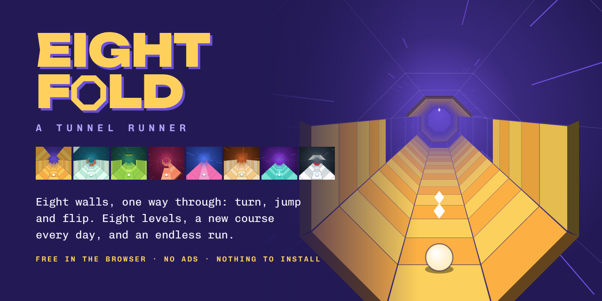

# Eightfold

A tunnel runner for the browser. Eight walls, one way through: turn the tunnel under you, jump, flip to the far wall, and do not fall out.

**Play it: https://jamesccupps.github.io/EightFold/**

The whole game is one self-contained file, `index.html`. No dependencies and no build step needed to play.

## Play

- In the browser at https://jamesccupps.github.io/EightFold/ (GitHub Pages serves the `main` branch, so a push updates it), or
- download `index.html` and open it locally.

Scores, key bindings and options are stored in the browser, per site.

## Controls

| Move | Keyboard (default) | Touch |
|---|---|---|
| Turn left / right | ← → or A D | swipe, tap a side, or the on-screen arrows |
| Jump | Space or ↓ | swipe down, or the Jump button |
| Flip to the far wall | ↑ or W | swipe up, or the Flip button |
| Pause / restart / sound | P or Esc / R / M | on-screen buttons |

Every key can be rebound under **Controls & options**, which also has a 75% practice speed, checkpoints, graphics quality and volume.

## What is in it

- **How to play:** a tutorial that stops at each obstacle and waits for the right key.
- **Eight levels.** Each one teaches its new obstacles alone, practises them mixed with the earlier ones, gives a breather at half way, then tests everything close together. A briefing before each level shows what is new and which key deals with it.
- **Endless:** no finish line; it speeds up and adds obstacles as you go.
- **Daily:** one 60-second course a day, generated from the date, the same for everyone.
- **Obstacles:** shifting floor, floor that continues overhead, tall blocks, low bars, short gaps and stepping stones, ring gaps, sliding blocks, launch pads, beams and fans, sprint zones and slow zones.
- **Sparks** mark the line (over each jump, past each opening). Each is worth points and adds speed, most of it from the first few, up to +25%. The view widens, the speed lines stretch and the music picks up as it builds. That speed is how a run beats its par time.
- **Helpers:** a shield sits on the route before stretches of things you can run into; slow-mo sits one lane off the route before rhythm sections, because it costs time. In Endless, a **magnet** (every spark you pass comes to you for six seconds) and **Double** (sparks are worth twice as much for eight) turn up one lane off the route. Anything that runs out shows a ring round the ball and a countdown at the top.
- **Ring gaps are always flipped across.** The only ones that can be jumped are the run of them inside a sprint zone, where jumping is the point.

### Scoring and speed

Points: sparks 100 (200 in the air, 300 for a red one), 50 for each perfect press, 10 per percent of progress, 1,000 for a clear, 100 per second under par, 1,000 for every spark.

Speed is where the skill shows. Three things make a run faster:

- **Sparks** add lasting speed, most of it from the first few, up to +25%.
- **Perfect timing.** A press in the last moment of a move's window (the last 0.09 s by default) is a perfect: a burst of speed that fades over three seconds. Each perfect in a row makes the burst bigger, up to +24%, so a streak keeps you flying and one early press drops you back.
- **Risk routes.** Three times a level, a calm stretch has three red sparks off the safe line: on a short strip along the far wall (flip over, flip back before it ends) or beside the floor (hop out, hop back). Each red spark adds 1% of speed beyond the cap, for the rest of the run. Staying on the safe line costs nothing but the time.

On level 1 the same course takes about 45 s on the safe line with early presses, 43 s with the risk routes, 42 s on the safe line with every press perfect, and under 40 s with both.

The level clock is not wall-clock time. It is stepped with the physics, so the same presses give the same time on any machine, and a run's time can be worked out again from its recording (`tools/replay.js` does this).

### Leaderboard

- **Levels and the Daily course:** fastest clear, to the hundredth of a second.
- **Endless:** how far you got. Endless is one course, the same for everyone and the same every day, so its board keeps from one day to the next. (The course is named by a date in `src/game.js`, `ENDLESS_COURSE`; changing that date starts a new course and a new board.) *Random course* on the result screen gives any other course for practice, unranked; the Daily course is the one that changes every day. Ties go to points.

A run that beats what the player has already posted is sent with its presses, under a name of up to three letters or digits. The best run not yet on its board is kept in the browser, whole, until the relay has taken it: if the player has not chosen a name yet, every result screen offers it until they do; if the relay is busy or the connection drops, it is sent again by itself (and on the next visit, if the tab was closed). Nothing is listed on trust: a GitHub Action on the `play-data` branch plays each run back on the real engine (`tools/boards.js`), and the time, distance and points shown are the ones the playback gives. That takes about a minute. Runs made with practice options or changed tuning do not count, and a board starts again when its course changes.

What is checked is the run, not the person. A run in which nearly every press lands at the last possible moment is the mark of a script: it is checked like any other but held back and not listed. Each browser's code is filed only as a one-way hash, so the public files give nobody what they would need to post under another player's row, and one player can post at most sixty scores a day. Each browser has one row per board, so changing the name relabels later runs instead of adding a row; names are not reserved, and when two players pick the same letters the board shows a short code after each so they can be told apart. Clearing the browser's storage makes a new player. Tying a name to one person would need sign-in, which the game does not have.

The version of the game and of its engine is shown at the bottom of the menu.

### Help for new players

**The next move is drawn on the floor.** On the last tiles where a press still works, an arrowhead points the way a turn goes, two arrowheads mark a flip (and the floor to land on, overhead, is outlined), and a bar marks a jump. A quarter of early players' runs ended on the wrong key, mostly a jump or a turn where a flip was needed; this says which move the floor wants. It can be turned off under Controls & options. When a run does end on a different move from the one needed, the result screen says which was pressed and which was needed.

**Legend** (on the menu, the briefing, the pause screen and the result screen) shows everything in one place: the three moves, each thing that can be picked up, the floor markings, every obstacle, what the readouts along the top mean, and how speed, points and the leaderboard work. The briefing before a level lists what matters in it, with the same pictures.

The first two times each kind of obstacle comes up outside the tutorial, a one-line reminder names it and the key that answers it. Risk routes get the same: that the red sparks are optional and how to reach them, then, once on the strip, how to get back. The strip is tinted red, turns full red after its last spark and ends at a white bar, so the moment to leave can be seen. Red sparks and their strip are the same red in every level. A shield, slow-mo and a red spark each say what they do the first couple of times one is picked up. After a fall, the result screen says what the run ended on and which move it needed.

Keys: a press acts at the next physics step (1/240 s), and a press made in the air is held until landing. On a keyboard set to another alphabet, W, A, S, D work by position. Each run records how long its key presses took to reach the game, so a slow machine or browser shows up in the play data.

## For developers and testers

- [docs/DEVELOPING.md](docs/DEVELOPING.md): how the levels are made, the layout of the repository, building, and the tests.
- [docs/PLAY-DATA.md](docs/PLAY-DATA.md): the tuning drawer, what play data is recorded, where it goes and how to read it.
- [relay/README.md](relay/README.md): the Cloudflare Worker that files play data and leaderboard scores.

## Credits

Inspired by the tunnel runners of early-2010s phones, Octagon in particular. All code, art, sound and level data here are original; nothing is taken from any other game. Fonts are Unbounded and Chivo Mono, loaded from Google Fonts.

## License

MIT. See [LICENSE](LICENSE).
